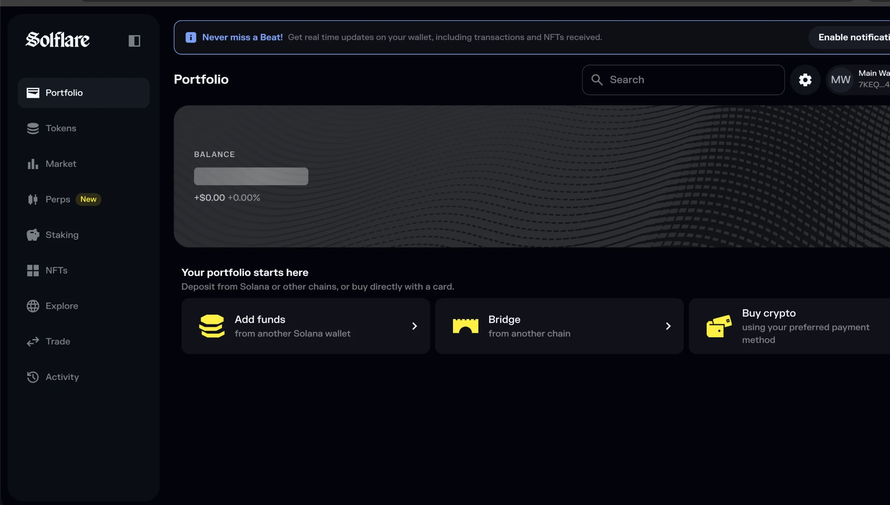
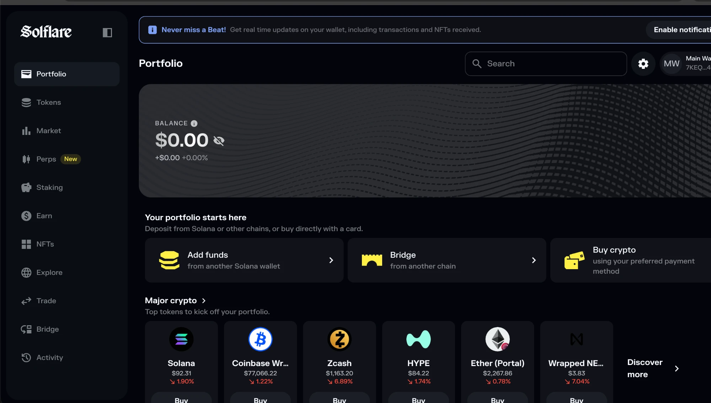

# Bugs

What I found while testing Solflare's wallet and API.

## UI bug

### The testnet balance never appears

**Severity:** Low

1. Open the wallet
2. Switch the network to testnet

**Expected:** `$0.00` and the hide icon, the same as on mainnet and devnet.

**Actual:** a grey loading bar, still there after more than 10 minutes in Chrome, and no hide icon. The line under it still shows `+$0.00 +0.00%`.

For the two addresses in the API tests, the API answers testnet normally with a 200 and a value of 0, so this looks like a problem in the app and not in the API.

Testnet:



Mainnet, with the same empty wallet:



## API bugs

Found on the production API (https://wallet-api.solflare.com) on 3 Nov 2026.

### 1. Requests sometimes stall

**Severity:** Needs investigation. High if real users hit it

Requests normally answer in under 6 seconds, but sometimes they take over a minute. The slowest took 103 seconds, and 3 got no answer before the test run ended. 6 of 46 test runs failed during the night, and it happened twice more during the day.

Even requests that should fail straight away, like one with a wrong token, were slow. Cloudflare's own responses stayed fast, so the delay looks to be behind it.

Both daytime times, at 10:06 and 12:52 UTC, a valid POST balances waited about a minute and then returned this:

```json
{ "error": "The operation was unable to achieve a quorum during its retry window.", "status": 400 }
```

That wording comes from Redlock, a locking library, so my guess is the server waited for a lock and gave up. Either way it shouldn't be a 400, because the request was fine.

I can't reproduce this on demand, and my tests sent a lot of requests that night, which may have played a part.

### 2. Malformed JSON returns a 500

**Severity:** Low

```bash
curl -s -X POST https://wallet-api.solflare.com/v2/portfolio/balances \
  -H "Authorization: Bearer $(uuidgen)" \
  -H 'Content-Type: application/json' \
  -d 'not json'
```

**Expected:** a 400, because the mistake is in the request. A body of `{}` already gets one.

**Actual:** a 500 with `HttpInternalServerError`.

Test API-13 covers this.

## Not a bug, but worth knowing

**Chrome headless is blocked.** solflare.com answers Chrome's headless browser with a 403, so `npm run test:e2e:chrome:headless` fails on the first screen. Chrome with a window and Firefox, with or without a window, all work. I didn't disguise the browser to get past the block. On a real project, I'd ask the team for an approved way through. The [README](../README.md#known-issues) has the details.
